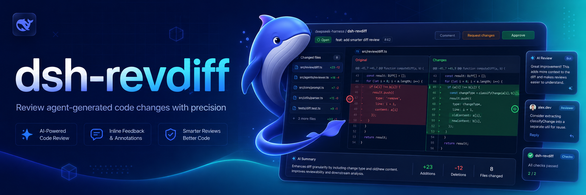

# dsh-revdiff



<p align="center">
  <a href="LICENSE"></a>
  <a href="package.json">=24"></a>
  <a href="package.json"></a>
  <a href="package.json"></a>
  <a href="https://awesome-dsh-plugin.com"></a>
</p>

<p align="center">English | <a href="README.zh.md">中文</a></p>

Native interactive diff review for [DeepSeek Harness](https://github.com/deepseek-ai/deepseek-harness). The plugin reads a Git unified diff, parses it into files, hunks, and line locations, presents its own terminal review interface, and queues submitted annotations as the Agent's next durable follow-up turn.

## Why this exists 💡

Reviewing a diff in a separate tool breaks the connection between the change, the review context, and the Agent that will act on the feedback. `dsh-revdiff` keeps review inside Harness, so annotations are created against the actual Git diff and returned to the same durable session.

## Features ✨

- Review tracked working-tree, staged, unstaged, or base-revision changes with optional path filters.
- Navigate between files, hunks, and diff lines from an interactive terminal.
- Add, edit, and delete issue, suggestion, question, or praise annotations.
- Submit structured annotations to the current Agent through `agent.followup()` with message provenance.
- Configure Git execution, diff context, size and time limits, terminal grace period, and comment length.

## Install 📦

Add this checkout to a Harness profile:

```sh
dsh plugin --profile demo add ./dsh-revdiff
```

The only external runtime requirement is Git in the same execution world as Harness.

## Use 🚀

```text
/revdiff
/revdiff --staged
/revdiff --unstaged
/revdiff main
/revdiff --base main -- src/index.ts README.md
```

The default reviews all tracked working-tree changes against `HEAD`, including staged and unstaged changes. `--staged` reviews the index, `--unstaged` reviews only worktree changes relative to the index, and a base revision reviews the working tree against that revision. Put path filters after `--`.

The Harness process must own an interactive terminal. The review interface supports:

- `↑`/`↓` or `k`/`j`: move between diff lines
- `n`/`p`: move between hunks
- `]`/`[` or `→`/`←`: move between files
- `a`: add an issue, suggestion, question, or praise annotation
- `e`: edit the selected line's annotation
- `d`: delete the selected line's annotation
- `s`: submit annotations to the current Agent
- `q`, Escape, or Ctrl-C: cancel without sending a message

Annotations retain the file, old/new side, line number, selected code, kind, and comment. They are sent through `agent.followup()` with `dsh-revdiff` message provenance, so the review enters the same Harness session rather than an external side channel.

## Configure ⚙️

Override the inserted row in a later Harness patch layer:

```yaml
- id: dsh-revdiff
  name: dsh-revdiff
  config:
    gitBinary: git
    contextLines: 3
    maxDiffBytes: 2097152
    diffTimeoutMs: 30000
    graceMs: 2000
    maxCommentLength: 4000
```

## Develop 🧑‍💻

```sh
pnpm install
pnpm run check
```

## Scope 🎯

Version 0.1 reviews textual changes already represented by `git diff`. Untracked files, binary patches, side-by-side rendering, mouse input, and a browser-hosted review surface are not included yet. The review engine and annotation model are owned by this project so those capabilities can evolve for Harness without following another review tool's interface.

## License 📄

MIT

## Credits 🙏

The product idea is informed by [`pi-diff-review`](https://github.com/badlogic/pi-diff-review) and [`revdiff`](https://github.com/umputun/revdiff), but this is an independent implementation built specifically around Harness commands, managed subprocesses, Agent lifecycle, and message provenance. It does not install, execute, wrap, or parse output from `revdiff`.
